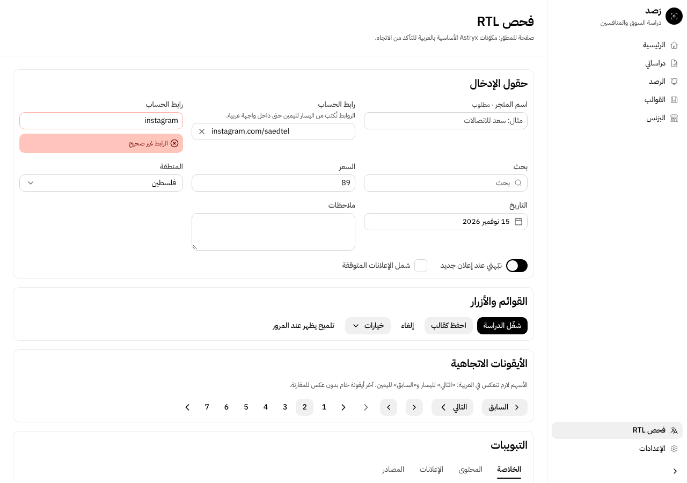
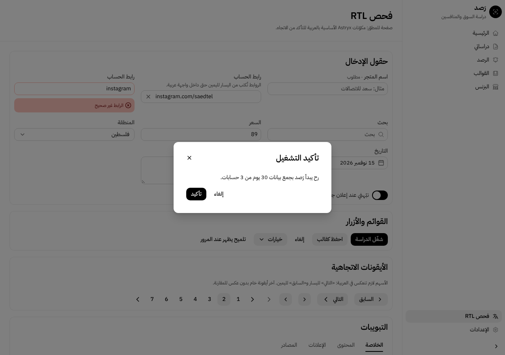
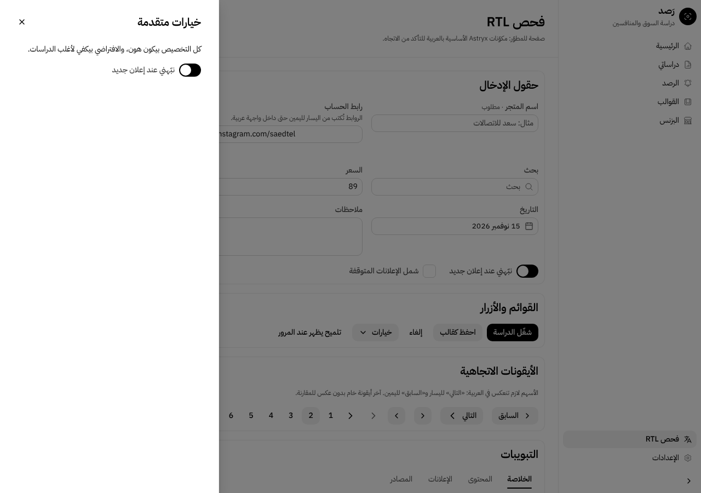
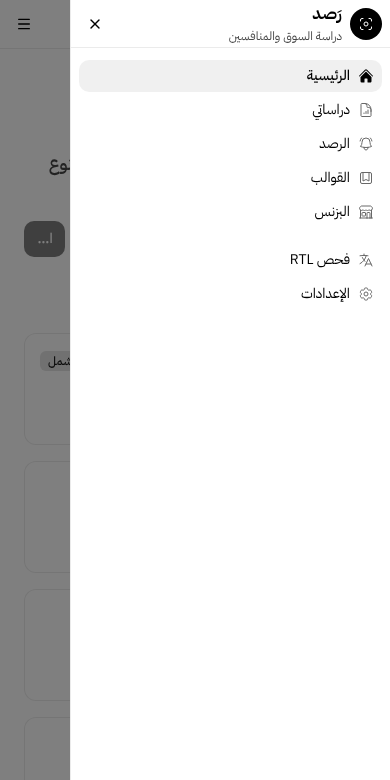

# RTL verification (Phase 0)

**Result: Astryx 0.7.16 supports RTL natively.** The build prompt assumed its docs do not mention RTL; they do
(`npx astryx docs internationalization/i18n-rtl-and-testing`), and the components behave correctly in Arabic.
We found no blocking issue in Astryx itself. The gaps are in **code we write around it**, and each has a fix
that is already in the repo.

Checked on Chromium (Playwright 1.63) at 1280×900 and 390×780, light and dark, with real Arabic strings.

## How RTL is wired

| Piece | Where | Note |
|---|---|---|
| `<html lang="ar" dir="rtl">` | `index.html`, kept in sync by `src/web/Providers.tsx` | Astryx does **not** set `dir` on `<html>`; the app must. Without it the browser does not right-align text or mirror layout outside Astryx components. |
| `<InternationalizationProvider locale dir messages>` | `src/web/Providers.tsx` | Tells Astryx components the direction and loads Astryx's own Arabic strings (shipped catalog `ar-SA`, loaded under `ar`). |
| Western digits | `formatLocale()` in `src/web/lib/locale.ts` → `ar-u-nu-latn` | The plain `ar` locale formats numbers as ٠١٢٣. The `-u-nu-latn` extension forces 0–9 everywhere, including inside Astryx (Calendar, DateInput, Pagination). Will become a setting in Phase 1. |
| App strings | `locales/ar/*.json` via i18next | Astryx strings and app strings use two providers side by side, as Astryx recommends. |

## What was checked

Re-run any time with the app running: `node scripts/rtl-screenshots.mjs` (writes `docs/rtl/*.png` and prints
the measurements below). The page it captures is `/dev/rtl` (dev builds only).

| Area | Result | How it was checked |
|---|---|---|
| App shell | ✅ Side nav on the right, content to its left | Measured: nav bounding box is in the right half |
| Side nav collapse button | ✅ Chevron points right (towards the edge it collapses to) | Zoomed screenshot |
| Mobile nav | ✅ Drawer slides in from the right, close button on the left | `mobile-nav.png` |
| Text inputs, textarea | ✅ Label, text, placeholder and status message start at the right; clear button on the left | `inputs.png`; computed `direction: rtl` |
| Search input start icon | ✅ Icon on the right | `inputs.png` |
| Selector | ✅ Value on the right, chevron on the left; menu aligned under the field | `selector-open.png` |
| Number input, date input, calendar | ✅ Mirrored; **Western digits** | Measured: no Arabic-Indic digits in the rendered text |
| Switch, checkbox | ✅ Control on the right of its label; the switch thumb travels to the left when on | `inputs.png` |
| Buttons, dropdown menu | ✅ Primary action first from the right; menu item icons on the right | `menus.png`, `menu-open.png` |
| Pagination | ✅ Page 1 on the right; previous/next chevrons mirrored | Measured: the SVGs carry a `scaleX(-1)` transform |
| Tabs | ✅ First tab on the right; **ArrowLeft moves to the next tab** | Keyboard test: focus tab 1 → ArrowLeft → tab 2 → ArrowLeft → tab 3 → ArrowRight → tab 2 |
| Table | ✅ First column on the right; `align: 'end'` columns align left | Measured: first header cell hugs the table's right edge |
| Dialog | ✅ Title on the right, close button on the left, actions end-aligned | `dialog.png` |
| Drawer | ✅ `side="end"` (the default) opens from the **left** | Measured: drawer box is at x = 0…400 of 1280 |
| Banner, progress bar | ✅ Icon on the right; bar fills from the right | `progress.png` |
| Astryx's own strings | ✅ Arabic ("مطلوب", "الانتقال إلى الصفحة السابقة") | Read from the DOM |
| Font | ✅ IBM Plex Sans Arabic 400/500/600 loaded from local files | `document.fonts` |



| Dialog | Drawer | Mobile nav |
|---|---|---|
|  |  |  |

## Issues found and how we handle them

### 1. Directional icons we render ourselves do not mirror

Astryx mirrors the chevrons **inside its own components** (Pagination, Calendar, SideNav…). An icon we place
ourselves — `<Icon icon="chevronRight" />` in a "Next" button — is drawn as-is, so in Arabic "التالي" would
point right, which is backwards.

Measured on `/dev/rtl`: four chevrons through our wrapper are mirrored, the raw `<Icon>` next to them is not.

**Fix (in repo):** `src/web/components/DirectionalIcon.tsx`. It takes a *logical* direction and applies
Astryx's own `rtlStyles.mirror`:

```tsx
<Button label={t('next')} endContent={<DirectionalIcon direction="forward" />} />
<Button label={t('back')} icon={<DirectionalIcon direction="back" />} />
```

**Rule:** never use `chevronLeft` / `chevronRight` / arrow icons directly in app code. Icons that are not
directional (search, download, trash, external link) need nothing.

### 2. Left-to-right content inside Arabic text gets reordered

URLs, `@handles`, commands and IDs are LTR. Dropped into an RTL line, the browser moves their edge
punctuation to the wrong side. Seen for real: the analysis command `/rasd-analyze 1` rendered as
`rasd-analyze 1/`.

**Fix (in repo):** `src/web/components/Ltr.tsx` wraps such content in `<bdi dir="ltr">`.

```tsx
<Code><Ltr>{command}</Ltr></Code>
<Ltr>@{handle}</Ltr>
```

**Rule:** anything a user might copy and paste (command, URL, handle, ID, file path) goes through `<Ltr>`.

When the value is interpolated into a translated **string** (so JSX is not available), wrap it with
`isolateLtr()` from the same file, which adds Unicode isolate marks. Seen for real: the home-page hint
showed `(@saedtel)` as `(saedtel@)` until the handle was isolated.

```tsx
t('suggestion.account_url_handle', {platform, handle: isolateLtr(`@${handle}`)})
```

### 3. Inputs meant for LTR values

A URL typed into an RTL field is hard to edit (the caret jumps around the dots and slashes).

**Fix:** pass `dir="ltr"` to that input. Verified: Astryx forwards it to the native `<input>`
(computed `direction: ltr`). Use it for URL, handle, and email fields. Free-text fields (product name, notes)
stay RTL — Arabic and Latin words mix fine there.

For a field that takes **either** (the home-page box accepts a URL or an Arabic product name), use
`dir="auto"`: the browser picks the direction from the first strong character typed. Seen for real: a pasted
`https://www.instagram.com/saedtel/` showed its trailing slash at the front until the box was set to `auto`.

### 4. Mixed-direction placeholders

`مثال: instagram.com/اسم_الحساب` rendered with the path before the domain. **Rule:** keep example
URLs out of Arabic placeholders; describe the input in words ("رابط حساب، أو اسم منتج…").

### 5. Our own layout code must use logical directions

Astryx layout props are logical already (`hAlign="start|end"`, `paddingInlineStart`, `side="start|end"`,
`placement="start|end"`). **Rule:** no `left` / `right` in app code, and no physical CSS. This is also what
makes the English locale work later without a second pass.

### 6. Number expressions inside Arabic text

`عرض «2+1»` rendered as `عرض «1+2»`. In an Arabic paragraph, digits are treated as Arabic numbers and a `+`
or `-` between two of them does not stay between them. **Fix (in repo):** `isolateNumberRuns()` in
`src/web/lib/bidi.ts` wraps expressions such as `2+1`, `10-15`, `530 + 88` in isolate marks. Plain numbers,
percentages and decimals are left alone.

**Rule:** any text that comes from a platform or from a Claude session (finding titles, claims, captions, ad
copy) goes through `isolateNumberRuns()` before it is shown.

### Phase 1 screens

Business list and form, Settings (sessions, limits, digits and currency, bridge status, recent jobs) and the
library filters were checked at 1280 and 390 px: no horizontal overflow, remove buttons at the end of each row,
URL and handle fields use `dir="auto"` (Arabic placeholder, Latin value), handles and paths go through `Ltr`.
Switching digits to ٠١٢٣ in Settings changes every number on screen, including dates in the library.

## Not verified yet

| Item | Why | When |
|---|---|---|
| Charts | `@astryxdesign/charts` on npm is a `0.0.0-bootstrap.0` placeholder; there is no chart component to test | Phase 5 — choose a chart approach, check axis direction and legends |
| PDF export | Needs the report view | Phase 5 — check page direction, embedded font, page breaks |
| Table with horizontal scroll / pinned columns | No wide table yet | Phase 5 (comparison matrix) |
| Toast, CommandPalette, Popover, HoverCard | Not used yet | When first used; add a block to `/dev/rtl` |
| Safari and Firefox | Only Chromium is available in the build environment | Before Phase 8 |
| Screen reader pass in Arabic | Needs a person | Phase 8 |
